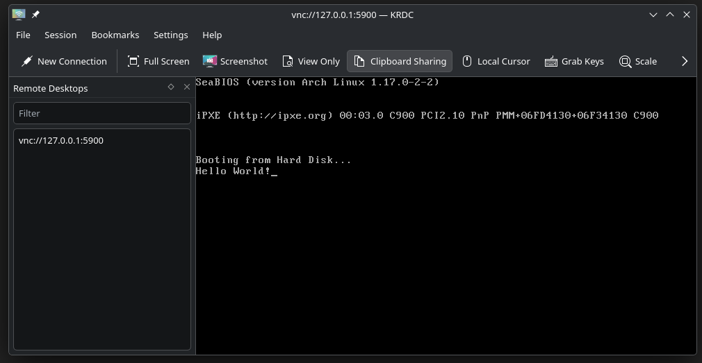

## Day 1 (10/10/2026), Part 1
Today I'm going to make some research on how an OS actually works (with all the ressources and links).
After some research I've found some websites and repos that are going to be usefull for this project, here they are :

- https://wiki.osdev.org
- https://github.com/tuhdo/os01
- https://www.geeksforgeeks.org/operating-systems/introduction-of-operating-system-set-1/
- https://medium.com/@Sky_higher_freak../understanding-the-computer-boot-process-60fd8fb138c4
- https://www.youtube.com/watch?v=ELTwwTsR5w8

(In short I'll suffer)<br>
To summarize, when you turn on your computer this happens :
<br>
1. You press the power button
2. This action make the power supply to provide electricity to the device's composants
3. It start the BIOS (old way) or the UEFI (modern way), it's a built-in program (on the motherboard) that will prepare the device's hardware to run the tests and later, our OS (you can read the 4th link for more details).
4. The POST (Power-On Self-Test) process starts, it'll check if the computer's hardware is working properly (for example if RAM (Random Access Memory) is missing, it will return an error and stop the device)
5. When the POST end, the bootloader will finally start our OS (if any bootloader is found by the BIOS or UEFI, the device will be shutted down)
6. Our OS starts and the startup process within (login page, etc...)
<br>

## Day 1 (10/10/2026), Part 2
In this project we're only gonna make the last steps, the bootloader and the OS.
So I'll direct my research on the bootloader for now, here's what I've found on it :
<br>
- https://en.wikipedia.org/wiki/Bootloader
- https://www.youtube.com/watch?v=E_n0VtGSZQY
- https://infosecwriteups.com/writing-a-bootloader-931da062f25b

<br>
Hell yeah, we're doing that, not today cause I need to learn more about that but maybe tomorrow.
We need to know that there's multiple mode in the boot execution (while the kernel in booting) here they are :
<br><br>

- **Real Mode** : It's a mode by default made by manufacturers to support old OS, the problem is : we just have 1MB of RAM and it uses a simple segmentation memory model (Segment:Offset) that isn't very secure... But there's another problem, in that mode, any program can have access to any memory location or hardware directly.
- **Protected Mode** : This mode is exactly what we need to have. It allows us to have 4GB of RAM (4000 times the real mode allowance !)
- **Long Mode** : It extends Protected Mode to support massive memory addresses and 64-bit registers.

<br>

But also, the bootloader code need to be in what is called the "boot sector", it's always the first 512 octets of your SSD and it needs to have this signature at the end of the 512 octets : `0xAA55`
(it can also be any other storage device that have these properties). <br>
I'll continue tomorrow, good night guys.

## Day 2 (08/11/2026)
I'm back.
Today I've finally made the bootloader (you can find it in /bootloader), here's how it works :

```asm
[BITS 16]
[ORG 0x7c00]
```
These lines are useless for us, it's just some indications for NASM. The first to define that we're working with 16 bits. The second start with `ORG` that means Origin, it define where our program will be loaded (we need to set it like that because it's the default address where the BIOS will try to boot after all the things we saw before).

```asm
start:
    cli ; stop all physical interruptions like keyboard entries, mouse, network, etc (it literally means "Clear Interrupt Flag").
    mov ax, 0x00 ; set the 0x00 value (so 0 in base 10) in the ax (accumulator) register
    mov ds, ax ; set ds (data segment) at the same value as ax (0)
    mov es, ax ; set es (extra segment) at the same value as ax (0)
    mov ss, ax ; set ss (stack segment) at the same value as ax (0)
    mov sp, 0x7c00 ; set sp (stack pointer) to 0x7c00 (the origin)
    sti ; sti stands for "Set Interrupt Flag" it's releasing our cli instruction we did before
    mov si, msg ; it moves the msg value into the si (Source Index) register
```
This is our start label, it's the first label that will be executed at the start of our program.

```asm
print:
    lodsb ; lodsb means "LOad String Byte", it loads the DS:SI octet into AL (Accumulator Low) 
    cmp al, 0 ; compare (cmp) al to 0
    je done ; if al = 0, we jump to the done label (je means "Jump if Equal)
    mov ah, 0x0E ; else we set ah (accumulator high-byte) to 0x0E (14 in base 10). This selects BIOS video service 0Eh: Teletype Output.
    int 0x10 ; interrupt the software with a 0x10 code (16 in base 10) that will display a single character (the one in al)
    jmp print ; then we jump to the print label (it's a loop that will stop only if the comparison at line 3 is True)
```
Now we need a print label that will be used to print text on our screen.

```asm
done:
    cli ; as we said before, cli stop all physical interruptions
    hlt ; stop all instruction and set the processor in HALT state
```
Then we have to make this label to end our program.

```asm
msg: db 'Hello World!', 0 ; we define our message in msg with db (data byte) that will indicate that we want to stock this in octets (so "Hello World!" become "48 65 6C 6C 6F 20 57 6F 72 6C 64 21 00" in memory) and ", 0" at the end to tell the print label that our string is ended here.

times 510 - ($ - $$) db 0 ; start with "times" that will repeat this instruction the number following the "times" instruction (so 510 - the number of octets already write in the section) and set 0 with the "db" instruction.

dw 0xAA55 ; tell the assembler to reserve and initialize 2 bytes (16 bit) to set 0xAA55 there. dw stands for "Define Word) btw
```
Finally, we define our message in the msg label, fill the remaining 510 bytes with 0, and set the value 0xAA55 at the end.
<br><br>

So that's all, for the moment, next we'll tell our bootloader to boot on our OS.


